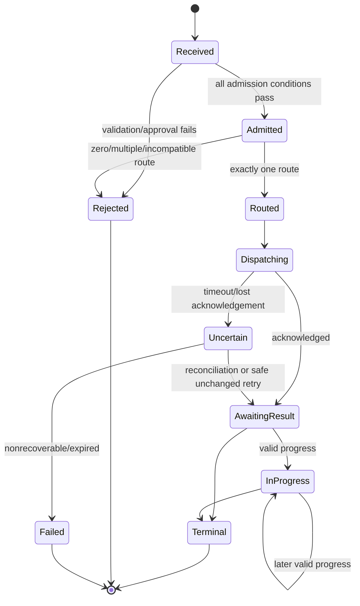
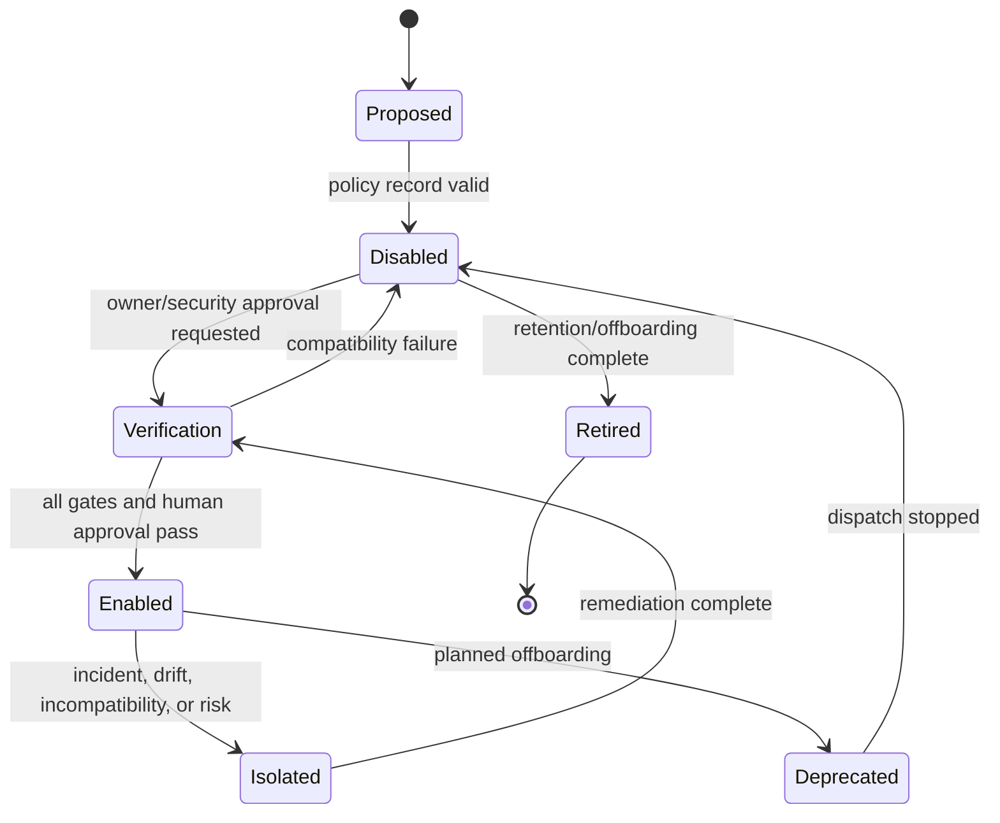
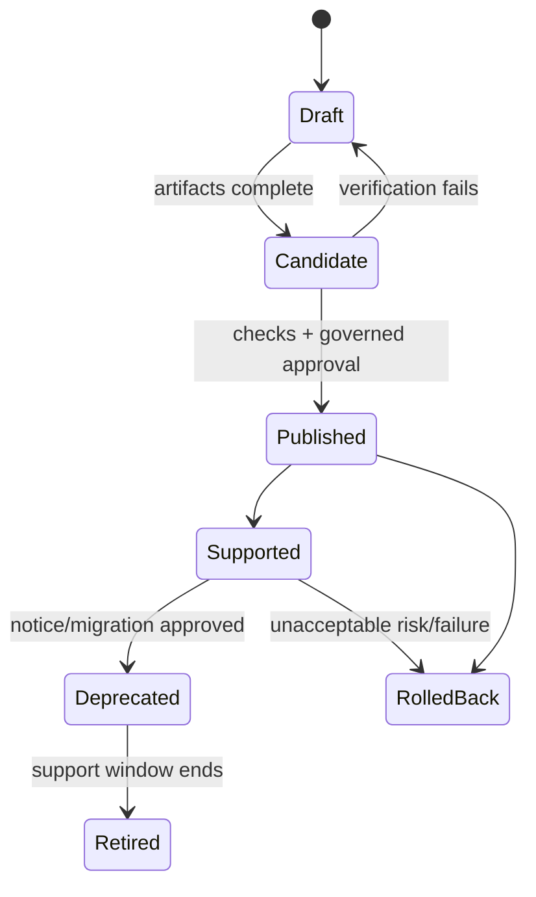

# State Models

## Delivery lifecycle

Terminal outcome variants include `succeeded`, `verified`, `duplicate-reused`, `ambiguous-rejected`, `cancelled`, `rejected`, and `failed` as supported by the active contract. Entry requires a schema-valid, identity-consistent result and required evidence. Terminal states cannot regress. Unknown/absent evidence remains awaiting, uncertain, or failed—not successful.

### Published 3.1.0 pre-execution journal guard (deployment pending)

The immutable `ai-sdlc-v3.1.0` release at reviewed merge commit
`e9d11fc99fee73d247c93699f058ed64786bd4c0`, recorded by separate
publication-attestation PR #114, introduces an explicit read-only trusted
journal guard **before** any cost-bearing target executor operation. The
compatible target implementation is immutable `codex-adapter-v3.1.0` at
`4f15841efcba4883770b5e32c0582f733d73eb91`. Its tag and publication
attestation do not establish source-consumer migration, deployed Runtime
Preflight, or REAL acceptance; `portfolio-tasks` still pins 3.0.3. The
published 3.1.0 deployed preflight must independently inspect the source
router job on `portfolio-tasks@main` and **reject** the old pin until its
separately approved migration is merged. A unique
trusted admission with **no** prior trusted result permits a new execution. A
single managed-draft receipt permits only an independently verified open
owned-draft `duplicate-reused` return; that also applies when receipt
persistence succeeded but source forwarding did not. All other terminal
receipts, malformed or conflicting trusted evidence, missing authorization
bindings, and indeterminate probes reject with no new executor call.

The journal is the authority for *terminal execution history*; a branch/PR
snapshot only proves *managed-draft reuse*. A successful preflight check is
necessary, not sufficient: the target shall recheck its ownership and current
authorization before acting. A new delivery after terminal failure requires a
fresh human-governed source identity. The diagram above describes outcomes,
not blanket permission to rerun completed deliveries.

## Registration lifecycle

Only `Enabled` is routable. Isolation affects one target without preventing unrelated target routing.

## Compatibility release lifecycle

Published identity and contents are immutable. Rollback selects a recorded known-good identity; it never mutates the failed release.

## Approval/admission lifecycle

An authored task becomes `Approved` only through authoritative human action. It may become `Stale` after material task/policy change or `Withdrawn` by authority. Admission requires `Approved` and fresh provenance at the decision point. A prior admission does not silently authorize changed work.

## Work lifecycle

```mermaid
stateDiagram-v2
  [*] --> proposed
  proposed --> approved: human approves current task ID
  approved --> queued: admitted for controlled routing
  approved --> withdrawn: approval revoked
  proposed --> superseded: material replacement
  approved --> superseded: approved revision changes
  queued --> executing: target accepts
  queued --> withdrawn: revoked before target starts
  queued --> cancelled: human cancels before start
  executing --> completed: validated terminal result
  executing --> failed: rejection/execution/validation failure
  executing --> cancelled: best-effort stop; no new effects
  completed --> [*]
  failed --> [*]
  withdrawn --> [*]
  cancelled --> [*]
  superseded --> proposed: replacement revision
```

`proposed` has no execution authority. `approved` is the only v2 task state accepted for admission and binds the task
identity to one target. `queued` is a post-admission source projection, not a
router authorization; it cannot be replayed through the v2 boundary. A material
edit receives a new task ID and fresh approval.
`executing` means the target accepted the delivery, not that it succeeded.
`completed` requires a valid success/verified/duplicate-reused result and, for
implement mode, validation evidence plus one managed draft PR. `failed` is a
terminal unsuccessful outcome. `withdrawn` revokes approval before execution;
`cancelled` is a human stop request/terminal disposition whose in-flight
interruption may be best-effort; `superseded` means a different revision needs
new approval. Terminal evidence is retained and never rewritten as success.
